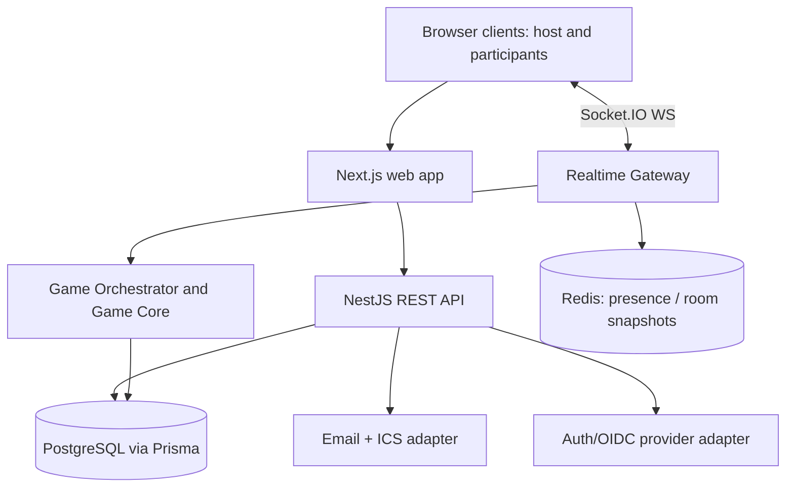

# Technical Architecture

## Decisions and scope

A browser-first TypeScript monorepo: `apps/web` Next.js, `apps/api` NestJS, `packages/ui`, `packages/contracts`, `packages/game-core`, `packages/config`. Use pnpm workspaces and Turborepo. Database: PostgreSQL/Prisma. Live ephemeral state: Redis. Transport: Socket.IO. Third parties via explicit adapters (email, calendars, auth provider). No native video in initial MVP.

## System context

Deploy web statically/server-rendered as needed, and deploy API/WebSockets as a long-running service. Serverless request functions are not a drop-in persistent Socket.IO host. Use managed PostgreSQL/Redis; no assumption that one server can host infinitely many rooms.

## Boundaries

- `apps/web`: UX, motion, forms, authenticated client, presentation/game components. Server cannot trust it for scores or time.
- `apps/api`: identity, RBAC, organizations, events/invitations, secure WebSocket gateway, use-case services.
- `packages/contracts`: Zod schemas for API requests/responses, Socket events, game actions and DTO types.
- `packages/game-core`: deterministic pure state transitions and validations, no network/database/UI imports.
- `packages/ui`: branded accessible components/tokens/icons/animations.
- `packages/config`: lint/type/test shared config.

## Critical state choices

Persistent: accounts, org/team membership, event/invite, consent records, question packs, completed game summaries, and audit records in Postgres.

Ephemeral: socket-to-user map, room participant presence, current round, deadline, accepted action IDs, game state snapshot in Redis. Use TTL, version numbers, and snapshot rebuild strategy.

Authoritative transitions: serialize events for each room (one room-owner actor/worker or transactional compare-and-swap); do not perform concurrent non-atomic read-modify-write on Redis. Use idempotency keys (`clientActionId`, room/round/actor scope) and deduplication window.

## Scalable room design

1. HTTP creates event/session in Postgres.
2. Realtime gateway verifies token, room membership, status and participant identity.
3. Room actor loads snapshot, ensures a single authoritative writer, assigns server deadline and revision.
4. Socket action -> validate Zod -> tenant/RBAC check -> dedupe -> game rule transition -> atomic snapshot/revision -> broadcast view-specific domain events + ack.
5. Clients detect missed revisions, request a fresh redacted snapshot, and derive countdown using server clock skew estimate.
6. At round/game completion, publish durable result records with idempotent writes; advance playlist only once.
7. TTL expires empty rooms and cleans memory; session state can recover from persisted checkpoints.

Horizontal Socket.IO adapters route messages across gateways but **do not by themselves** solve room ownership, persisted replay, or reconnect state. Validate Redis adapter semantics and transport strategy during P4; document if websocket-only is selected and any impact on fallback/sticky sessions.

## Reliability notes

- All game answers expire at authoritative server deadlines, even if UI timer lags.
- Acknowledge actions with accepted/duplicate/rejected and authoritative revision.
- Host transfer requires explicit cohost rule / grace interval; never grant host privileges just because a client claims them.
- Use monotonic-ish server time for countdown/round ordering, not client-submitted timestamps.
- Expose bounded actions per socket (rate limit, payload limit, stroke throttling for drawing).
- Cache shared data carefully; always cache with tenant namespaces.

## Deployment phases

**Local:** Docker Compose PostgreSQL/Redis, web/API processes with pinned Node/pnpm.
**Staging:** isolated tenants/test identities, seeded games, automated smoke and E2E runs.
**Production:** managed Postgres, Redis, object store, host service with WebSocket support; tracing, error reporting, backups, scaling metrics, secret management, documented rollback.

## ADR triggers

Write an ADR before committing to: auth provider, session ownership/locking method, scoring time model, video, socket fallback transport, multi-region approach, paid email/calendar providers, and public brand naming.

See `docs/TECH_STACK.md`, `docs/API_AND_EVENTS.md`, `docs/DATA_MODEL.md`, and `docs/OPERATIONS.md`.
